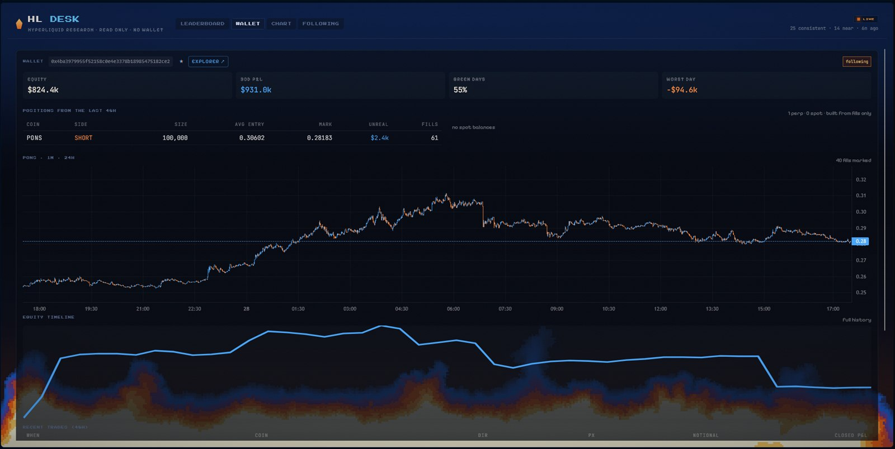

# HL DESK: a self-hosted Hyperliquid research desk

Read-only research over Hyperliquid perps. It screens trader wallets, replays the last 48 hours of
their fills to work out what they actually built, charts price with a MACD pane, and can post fill
alerts to a Discord webhook. No wallet, no keys, no orders. Nothing here trades.

The public demo at <https://ferno.fun/hl/> is a frozen snapshot of the same UI.



## What it does

**Screener.** Pulls the Hyperliquid leaderboard, then checks the 400 largest accounts against four
tests over the last 30 days: active in the last 48h, green days at 48% or more, no single day worth
more than 70% of profit, and a worst day better than -30% of equity. Wallets that pass are listed as
consistent; wallets that fail exactly one test are listed as near misses with the test they failed,
so the board still shows the interesting ones. Equity floor is $10k.

**Wallet page.** Equity curve, candles with the wallet's fills marked, the explorer link, and the
position table. Positions are rebuilt from the last 48h of fills only, with average-cost accounting,
so "size 500 entered at 2,719" from a trade three weeks ago does not show up as a current position.
The venue's own total is kept as a hover hint when it differs. Trades are paginated.

**Chart.** Alphabetical, searchable token picker; blue up / orange down candles; a measure tool you
arm with a button and finish with two clicks; MACD 12/26/9 plus a zero-lag band aligned to the price
pane.

**Following.** Star any wallet. Its card carries the same numbers as the leaderboard plus its newest
fill and how that position is doing right now. Optional Discord webhook: one alert per token per 15
minutes, so a burst of fills does not spam the channel.

**Passcode gate.** Set `SITE_PASSCODE` and every page and `/api/*` route needs it, with an HttpOnly
HMAC cookie and a 10-attempt / 10-minute lockout. Leave it empty to run open on your own box.

## Quick start

```bash
npm install
npm run dev
```

That starts the engine on `http://localhost:8899` and Vite on `http://localhost:5173` with `/api`
proxied to the engine. Open the Vite port while developing.

Production:

```bash
npm run build
SITE_PASSCODE=choose-something npm start
```

`npm run build` writes the static bundle to `dist/`, which the engine serves itself. The whole app
then lives on one port, `8899` by default.

## Configuration

| Variable | Default | What it does |
|---|---|---|
| `PORT` | `8899` | Port the engine listens on |
| `DATA_DIR` | `./data` | Where the follow list, webhook and screener cache are written |
| `SITE_PASSCODE` | empty | Gate for the whole app. Empty means no gate |

`DATA_DIR` is created on demand. Back it up if you care about your follow list.

## How it gets data

Public Hyperliquid endpoints only, no account or API key:

- `POST https://api.hyperliquid.xyz/info` with `leaderboard`, `clearinghouseState`,
  `userFillsByTime`, `userFills`, `candleSnapshot`, `allMids`, `meta`, `spotMeta`
- `https://stats-data.hyperliquid.xyz/Mainnet/leaderboard` for the address list

The engine refreshes the board every 10 minutes and caches wallet, chart and stats responses, so a
page view rarely hits the API twice. Hyperliquid returns 429 under load; the caches absorb it and a
failed lookup falls back to the last good copy.

Two data rules worth knowing:

- `pnlHistory` is cumulative, so daily figures come from differences, never raw points.
- Spot fills arrive with asset ids like `@272`. They are mapped through `spotMeta` to `UZEC/USDC`
  and friends before display.

## Hosting it for real

`deploy/` has a systemd unit and an nginx server block. The short version: build, run
`node_modules/.bin/tsx src/server/index.ts` under a service user with `SITE_PASSCODE` in the unit,
and reverse proxy to `127.0.0.1:8899`.

The gate is a passcode over plain HTTP unless you put TLS in front of it, in which case the passcode
stops strangers rather than a determined snoop. Put TLS in front.

## Limits

- Read-only by design. There is no order path in this codebase and adding one is on you.
- The 48h position window is deliberately short. A position opened earlier shows only the fills
  inside the window, which is why the venue total is kept beside it.
- Funding, fees and liquidations are not modelled.
- Not financial advice. A wallet that looks consistent for 30 days is a wallet that looked
  consistent for 30 days.

## License

MIT. See `LICENSE`.
